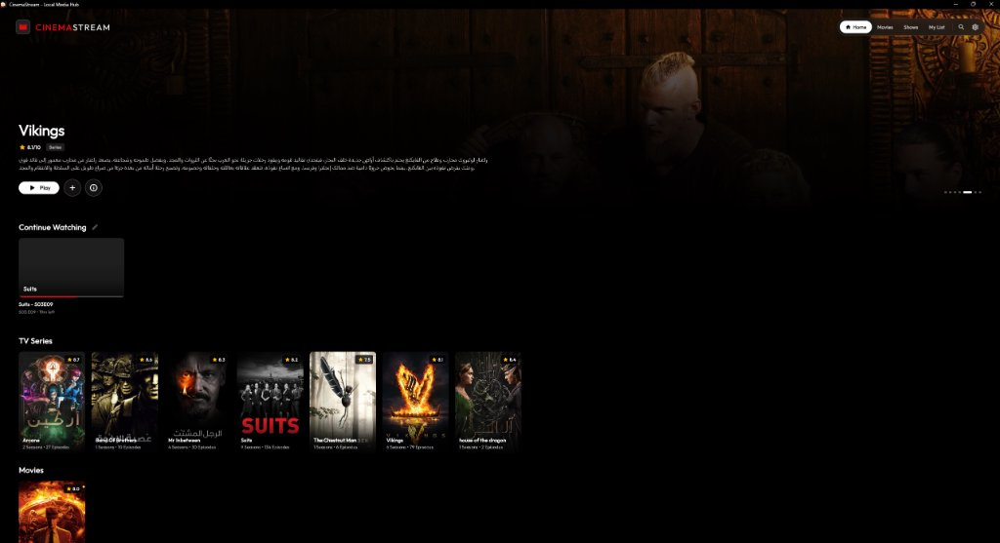
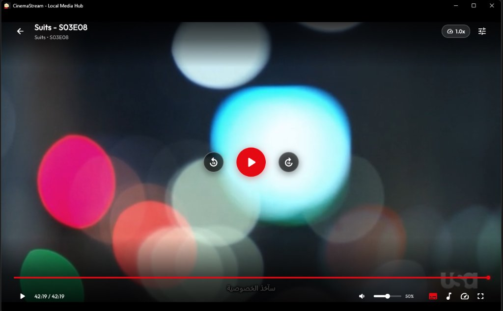
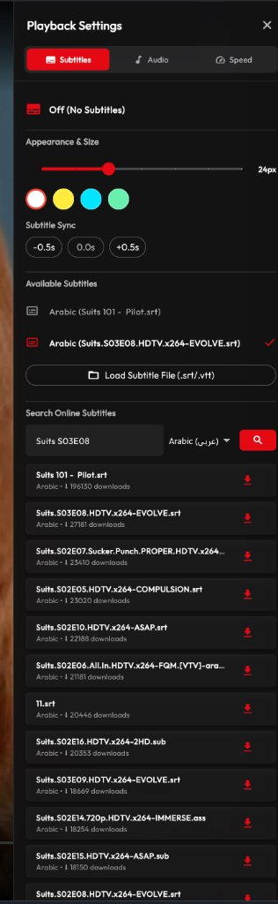
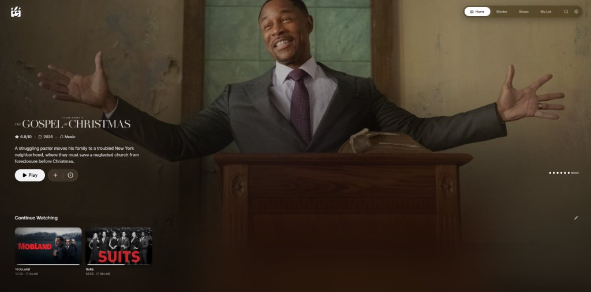

<div align="center">

  

  # CinemaStream

  **A Fast, Cinematic Local Media Hub & Video Player for Windows 11**  
  *Powered by Flutter, libmpv Hardware Acceleration, and Liquid Glass iOS 27 Aesthetics.*

  <p align="center">
    <a href="https://github.com/xAbdull7/CinemaStream/releases/latest"></a>
    
    
    
    
    
  </p>

  <p align="center">
    <a href="#-quick-download"><b>📥 Download Setup</b></a> •
    <a href="#-key-features"><b>✨ Features</b></a> •
    <a href="#-ui-showcase"><b>🖼️ Screenshots</b></a> •
    <a href="#-auto-updates"><b>🔄 Auto-Updates</b></a> •
    <a href="#-shortcuts"><b>⌨️ Shortcuts</b></a> •
    <a href="#-building-from-source"><b>🛠️ Build</b></a> •
    <a href="#-نبذة-عن-المشروع-arabic-summary"><b>🇸🇦 العربية</b></a>
  </p>

</div>

---

## 📥 Quick Download

Get the official standalone Windows installer (packaged with Inno Setup 6, ultra-compressed at only ~24.8 MB):

| Platform | Installer Package | Size | Hash (SHA-256) |
| :--- | :--- | :--- | :--- |
| **Windows 11 / 10 (64-bit)** | [**CinemaStream_Setup_v1.0.0.exe**](https://github.com/xAbdull7/CinemaStream/releases/latest/download/CinemaStream_Setup_v1.0.0.exe) | `~24.8 MB` | `CED4FE9DADD2C6DC58BCB75EB428C3F10B2D586D585AB67B735B4327459B4099` |

> [!TIP]
> **Zero Admin Hassle:** The installer runs in dual-mode (`PrivilegesRequired=lowest`). It installs directly for the current user into `%LocalAppData%\Programs\CinemaStream` without triggering annoying UAC prompts, while supporting system-wide administrative installations if run as Administrator.

---

## ✨ Key Features

### 💎 Liquid Glass iOS 27 Design System
* **Acrylic Frosted Glass:** Deep multi-pass backdrop blur (35px) with directional specular highlights and ambient dark glows.
* **Floating Pill Navigation:** Dynamic pill navbar that auto-adapts across Home, Movies, TV Shows, and Watchlist, featuring an integrated expandable search bar.
* **Massive Hero Banner:** 74% viewport height cinematic hero showcase highlighting your latest series and movies with rich metadata and backdrop art.
* **Responsive 16:9 Continue Watching:** Horizontal Netflix-style cards displaying exact remaining watch time, watched progress bar, and custom editing capabilities.

### ⚡ Professional Video Engine (libmpv)
* **NVIDIA RTX Video Super Resolution (VSR):** Deep learning AI upscaling running directly on RTX Tensor Cores (`d3d11vpp`). Automatically enhances 720p/1080p content in real-time with an active neon `⚡ RTX VSR` HUD badge and seamless fallback for non-RTX systems.
* **GPU Hardware Decoding:** Zero CPU strain when playing heavy 4K UHD 60fps HEVC / AV1 / H.264 files via Direct3D11 & Vulkan.
* **Instant Scrubbing:** Real-time seeking with zero playback stutter and interactive red progress scrubber.
* **Smart Next Episode:** Floating prompt 15 seconds before episode end to smoothly jump to the next episode.
* **Adaptive Aspect Ratio & Audio Pitch Correction:** Smooth speed adjustment (0.5x to 2.0x) maintaining pitch clarity.

### 🌐 Dual-Layer Subtitles & Audio Engine
* **Automatic Local Detection:** Automatically discovers and matches `.srt`, `.vtt`, `.sub`, `.ass` files sharing the video folder.
* **Online OpenSubtitles Integration:** Search, filter by language (Arabic, English, French, Spanish, etc.), and download synchronized subtitles in 1 click without leaving the player.
* **Full Typography Control:** Custom subtitle font sizes, 4 signature color palettes (Pure White, Studio Yellow, Cyan, Mint Green), and ±0.5s sync calibration.

### 🔄 In-App Auto-Update System
* **Background Check:** Automatically checks GitHub Releases upon application startup.
* **Liquid Glass Update Modal:** View release notes, changelog highlights, and download progress directly in-app.
* **Seamless Self-Update:** Downloads and runs the setup package detached, replacing files cleanly and relaunching automatically.

### 🪟 Windows 11 Native Integration
* **File Associations:** Registers `.mp4`, `.mkv`, `.avi`, `.mov`, `.webm`, `.flv`, `.ts` with Windows shell.
* **Context Menu:** Right-click any video in Windows Explorer -> **"Play with CinemaStream" (تشغيل بواسطة CinemaStream)** with official mascot branding.
* **Command-Line Launch:** Double-clicking associated video files opens and plays them instantly.
* **Clean Uninstaller:** Full integration with Windows *Apps & Features* with complete registry and cache cleanup.

---

## 🖼️ UI Showcase

<div align="center">

### Home View — Immersive Hero Banner & Floating Pill


<br/><br/>

### Video Player — Custom Red Scrubber, Dynamic HUD & Volume Capsule


<br/><br/>

### Subtitles & Audio — Online OpenSubtitles Search & Appearance Customizer


<br/><br/>

### Series & Episodes Explorer — Season Selector & Metadata Enrichment


</div>

---

## ⌨️ Desktop Shortcuts

| Key | Action |
| :--- | :--- |
| <kbd>Space</kbd> | Play / Pause |
| <kbd>→</kbd> | Seek Forward 10 seconds |
| <kbd>←</kbd> | Seek Backward 10 seconds |
| <kbd>↑</kbd> | Volume Up (+5%) |
| <kbd>↓</kbd> | Volume Down (-5%) |
| <kbd>M</kbd> | Mute / Unmute Audio |
| <kbd>F</kbd> or <kbd>F11</kbd> | Toggle True Borderless Fullscreen |
| <kbd>Esc</kbd> | Exit Fullscreen / Back to Library |

---

## 🔄 Auto-Update & CI/CD Pipeline

CinemaStream features an end-to-end automated release pipeline powered by **GitHub Actions** and **Inno Setup**:


### How to Publish a New Update:
1. Bump version in `pubspec.yaml` (e.g. `1.0.1+2`) and `installer/cinemastream_setup.iss`.
2. Commit and tag the release:
   ```bash
   git add .
   git commit -m "Release v1.0.1"
   git tag v1.0.1
   git push origin main --tags
   ```
3. GitHub Actions automatically builds the Windows executable, packages the Inno Setup installer, and publishes the release on GitHub.
4. All installed user clients will automatically detect the new update upon their next launch!

---

## 🛠️ Building from Source

### Prerequisites
* Windows 10/11 (64-bit)
* [Flutter SDK](https://flutter.dev) (v3.16.0 or higher)
* [Visual Studio 2022](https://visualstudio.microsoft.com/) with *Desktop development with C++*
* [Inno Setup 6](https://jrsoftware.org/isdl.php) (for compiling installer)

### Step-by-Step Build:
```bash
# 1. Clone the repository
git clone https://github.com/xAbdull7/CinemaStream.git
cd CinemaStream

# 2. Get dependencies
flutter pub get

# 3. Build release executable
flutter build windows --release

# 4. (Optional) Compile standalone Setup executable
scripts\build_release.bat
```

The compiled installer will be available at:
`installer/output/CinemaStream_Setup_v1.0.0.exe`

---

## 🇸🇦 نبذة عن المشروع (Arabic Summary)

**CinemaStream** هو مشغل وسائط ومكتبة سينمائية متطورة ومصممة خصيصاً لنظام التشغيل ويندوز 11 تجمع بين فخامة تصميم **Liquid Glass (iOS 27)** وسرعة محرك التشغيل الاحترافي **libmpv** مع تسريع العتاد عبر كارت الشاشة (GPU).

### أبرز الميزات:
* ⚡ **تحسين الفيديو بالذكاء الاصطناعي (NVIDIA RTX VSR):** دعم كامل لكروت NVIDIA RTX لمضاعفة دقة الفيديوهات 720p/1080p في الوقت الفعلي عبر أنوية Tensor بدقة فائقة وشارة خضراء مميزة.
* 🎨 **واجهة زجاجية عائمة (Liquid Glass):** تدرجات لونية، ضبابية بصرية عميقة (Blur 35px)، وتصميم يحاكي أحدث معايير الواجهات العالمية.
* 🎬 **تشغيل فائق الدقة (4K@60fps):** استهلاك شبه معدوم للمعالج بفضل فك التشفير عبر كارت الشاشة.
* 💬 **نظام الترجمة المتطور:** قراءة الترجمات المحلية وتنزيل الترجمات المتوافقة مباشرة من **OpenSubtitles.org** مع تعديل حجم ولون ومزامنة الخط فورياً.
* 🔄 **تحديثات برمجية تلقائية:** فحص ذكي لأحدث الإصدارات عبر GitHub وتثبيتها بنقرة واحدة من داخل التطبيق.
* 📦 **حزمة تثبيت عالمية (Inno Setup 6):** دعم كامل للغة العربية، وتكامل مع قائمة النقر بالزر الأيمن في ويندوز (Play with CinemaStream).

---

## 📄 License

This project is licensed under the MIT License — see the [LICENSE](LICENSE) file for details.

<div align="center">
  <sub>Crafted with passion for cinema lovers. Maintained by <a href="https://github.com/xAbdull7">@xAbdull7</a>.</sub>
</div>
